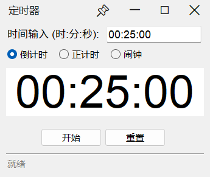

# Clock — Windows 桌面定时器

极简 Windows 桌面定时器：**倒计时 / 正计时 / 闹钟** 三种模式，微信式无边框原生窗口，可置顶，纯 Python 标准库实现、零第三方依赖，单文件不到 900 行。



## 特性

- **无边框但是"真"原生窗口**：通过 Win32 消息拦截实现自定义标题栏（不是 `overrideredirect` 假窗口），原生拖拽、边缘缩放、Aero Snap、任务栏、阴影、Win11 圆角全部保留
- **置顶图钉**：标题栏一键图钉置顶，看视频/码字时悬浮计时
- **三种计时模式**：
  - 倒计时——到 0 自动响铃并转入正计时（记录溢出时间）
  - 正计时——清零起表
  - 闹钟——输入 24 小时制时刻，大屏走实时时钟，到点响铃弹窗
- **DPI 感知**：高分屏缩放下窗口原生渲染不模糊，数字大小随窗口缩放自适应
- **零依赖**：主程序只用标准库 + tkinter；非 Windows 平台自动回退系统标题栏 + 复选框置顶

## 快速开始

### 方式一：下载 exe（不需要 Python）

到 [Releases](https://github.com/futation/Clock/releases) 页面下载 `Clock-v1.0.exe`，双击即用。

### 方式二：源码运行

需要 Windows + Python 3.8+（tkinter 随 Python 自带）：

```bash
git clone https://github.com/futation/Clock.git
cd Clock
python clock.py
```

### 打包自己的单文件 exe

```bash
pip install pyinstaller
python -m PyInstaller --noconfirm --clean --onefile --windowed --icon=Clock.ico --add-data "Clock.ico;." --name Clock clock.py
```

产物在 `dist/Clock.exe`。

## 使用说明

| 模式 | 输入格式 | 行为 |
| --- | --- | --- |
| 倒计时 | `时:分:秒`（也支持 `分:秒` 或纯秒） | 到 0 响铃，自动转正计时；切走再切回会记住上次输入 |
| 正计时 | 无需输入 | 从 0 开始计 |
| 闹钟 | 24 小时制 `时:分:秒` | 大屏实时走当前时钟，按开始后显示剩余时间，到点响铃；时刻已过则定为明天 |

窗口可任意拖拽、缩放，时间数字大小自适应窗口；标题栏按钮从左到右为图钉（置顶）、最小化、最大化/还原、关闭。

## 目录结构

| 文件 | 说明 |
| --- | --- |
| `clock.py` | 主程序（UI + 计时逻辑 + Win32 互操作） |
| `img2ico.py` | 图标生成小工具：把任意图片转成多尺寸 .ico（需 Python 3.9+ 和 `pip install pillow`） |
| `Clock.ico` | 应用图标 |
| `Clock.spec` | PyInstaller 打包配置 |
| `docs/` | 开发踩坑记录、截图 |

## 开发文档

[docs/开发踩坑记录.md](docs/开发踩坑记录.md) 记录了无边框窗口、Win32 消息拦截、ctypes、DPI、窗口缩放防抖等实现细节与踩坑经验，想复刻或改造界面的话推荐先读。

## License

[MIT](LICENSE)
